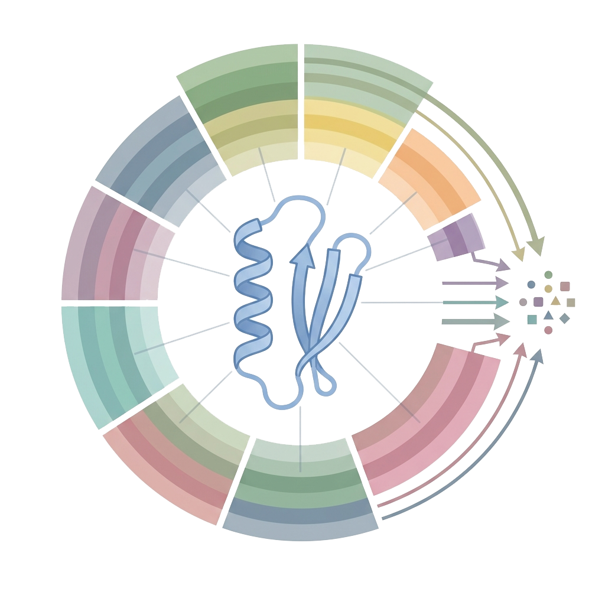
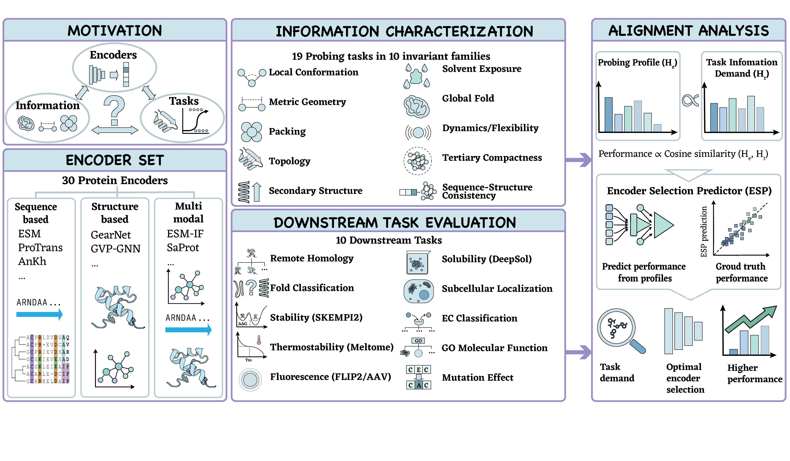

#  ProtEncEval: What Protein Structure Encoders Know, What Biological Tasks Require, and How to Choose the Right Model

<p align="center">
  
</p>

## Overview

Protein encoders provide compact representations of protein sequence and structure for biological modeling, yet they are typically evaluated by aggregate downstream accuracy alone. This makes it difficult to determine what information an encoder captures, why it succeeds on some tasks, or how to select an encoder for a new biological problem.

**ProtCompass** is an interpretable benchmark and analysis framework for task-aware evaluation of protein encoders. We evaluate **26 encoders** (sequence-based, structure-based, and multimodal) along two complementary axes:

1. **Probing Suite**: Measures how well embeddings preserve 10 invariant information properties (IIPs):
   - Local geometry, secondary structure, solvent exposure, flexibility
   - Packing, residue contacts, global geometry, fold identity
   - Sequence information and sequence-structure consistency

2. **Downstream Benchmark**: Evaluates transfer performance across 14 biological tasks:
   - Structural prediction (secondary structure, contact prediction, remote homology)
   - Functional annotation (EC classification, GO terms)
   - Protein-protein interaction (interface sites, binding affinity)
   - Mutational effect prediction
   - Biophysical properties (stability, fluorescence, solubility)

### Key Findings

**Encoders capture distinct biological profiles.** Different encoders preserve different combinations of structural and biochemical information. There is no single global ranking—encoder performance depends on task-specific information demands.

**The Information Alignment Hypothesis (IAH).** An encoder performs best when its invariant information property profile aligns with the information required by the target task. This principle enables:
- **Task interpretation**: Understanding what information each biological task requires
- **Encoder selection**: Choosing the right encoder for a new application without trial-and-error
- **Performance prediction**: Estimating downstream utility from probing profiles alone

### Practical Tools

- **ESP & ESP++ Selectors**: Predictors that estimate an encoder's downstream utility based on probing profiles, enabling principled model selection prior to executing tasks
- **Encoder Information Profiles**: Quantitative characterization of what each encoder captures
- **Task Information Demands**: Inferred requirements for each downstream task
- **Selection Guide**: Evidence-based recommendations for encoder choice

## Repository Structure

The current codebase is organized into key modules to facilitate experimentation, replication, and exploration:

- **`src/`**
  Core logic and implementations for the ProtEncEval framework.
  - `/models/`: Interfaces and wrappers for the 30 tested structure- and sequence-based protein encoders.
  - `/probes/`: Implementation of linear and complex probes for the 19 biological invariant families.
  - `/tasks/`: Execution and validation protocols.
  - `/analysis/` & `/interpretation/`: Logic for the ESP and ESP++ encoder selection predictors.
  - `/visualization/`: Scripts for plotting and generating figures.

- **`downstream_tasks/`**
  Contains the dataset processing, definitions, and inference scripts for the 9 selected biological downstream tasks (e.g., function annotation, fitness prediction).

- **`reproduction_package/`**
  Contains the necessary scripts, configurations, and instructions dedicated to accurately replicating the experimental results and extracting the model invariant profiles from the paper.

- **`figures/`**
  Contains the main paper graphics, including the `main.png` framework overview.

- **`external_repos/`**
  Third-party encoder implementations. See [EXTERNAL_REPOS.md](EXTERNAL_REPOS.md) for installation instructions and links to original repositories.

**Note:** Large datasets and pre-computed embeddings are hosted on HuggingFace (see Data Download section below).

---

## Data Download

This repository contains only the source code. Large datasets and pre-computed embeddings are hosted on HuggingFace:

### Datasets (ProtEnv)
Download raw datasets and predicted structures from HuggingFace:

```bash
# Install HuggingFace CLI
pip install huggingface_hub

# Download datasets (117GB)
huggingface-cli download Anonymoususer2223/ProtEnv \
    --repo-type dataset \
    --local-dir structure_encoder_data
```

**Contents:**
- Raw sequences, labels, and LMDB files for all tasks
- PDB structure cache (46GB)
- TAPE benchmark datasets
- ProteinWorkshop tasks
- ProteinGym mutation data
- And more (see [ProtEnv README](https://huggingface.co/datasets/Anonymoususer2223/ProtEnv))

### Pre-computed Embeddings (ProtCompass_Embeddings)
Download pre-computed embeddings and evaluation results:

```bash
# Download embeddings and results (~150GB compressed)
huggingface-cli download Anonymoususer2223/ProtCompass_Embeddings \
    --repo-type dataset \
    --local-dir .
```

**Contents:**
- Pre-computed embeddings from 70+ encoders across 13 tasks (compressed)
- Probing task embeddings and results
- Evaluation results for all encoder-task combinations
- Analysis outputs and paper figures

**Decompression:**
```bash
# Decompress all tasks
cd embeddings/
for f in *.tar.gz; do tar -xzf "$f"; done

# Or decompress specific task
tar -xzf secondary_structure.tar.gz

# Or decompress specific encoder (for large tasks)
cd contact_prediction/
tar -xzf esm2.tar.gz
```

### External Encoder Repositories
Clone third-party encoder implementations:

```bash
# See EXTERNAL_REPOS.md for detailed instructions
cd external_repos
# Follow installation instructions in EXTERNAL_REPOS.md
```

---

## Installation

### Environment Setup

Create the conda environment from the provided YAML file:

```bash
# Create environment
conda env create -f environment.yml

# Activate environment
conda activate protcompass

# Verify installation
python -c "import torch; print(f'PyTorch {torch.__version__}, CUDA: {torch.cuda.is_available()}')"
```

The `environment.yml` file includes all dependencies for:
- Running all 70+ protein encoders
- Executing probing and downstream tasks
- Generating visualizations and analysis

### Quick Start

After setting up the environment and downloading data:

```bash
# Run probing tasks
python scripts/run_probing.py --encoder esm2 --task secondary_structure

# Run downstream evaluation
python downstream_tasks/evaluate_tasks.py --encoder esm2 --task ec_classification

# Generate visualizations
python scripts/visualize_paper_v12.py
```

---
