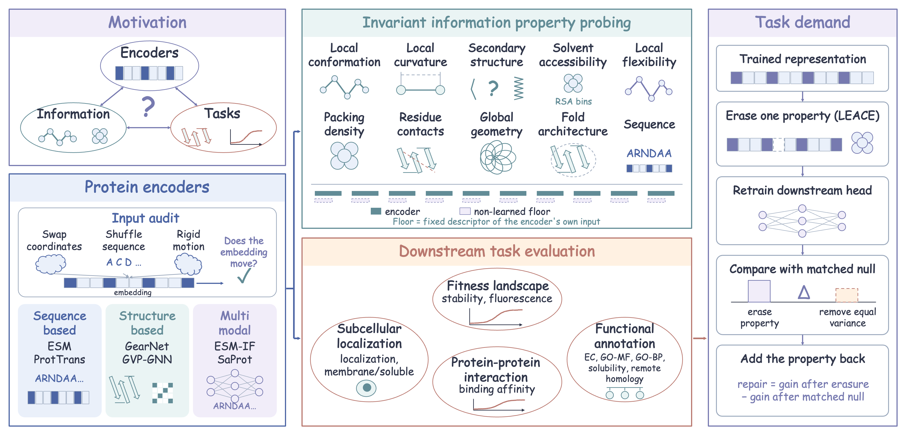
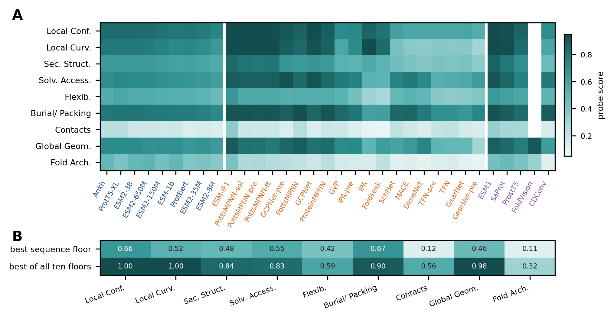
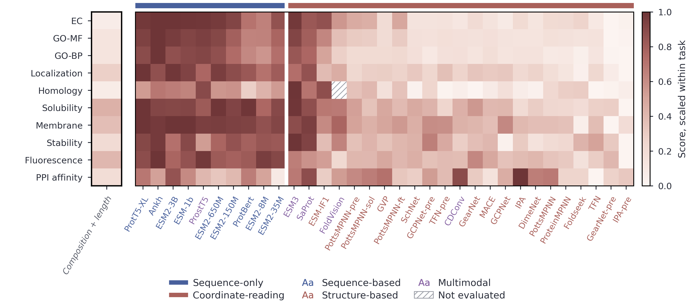
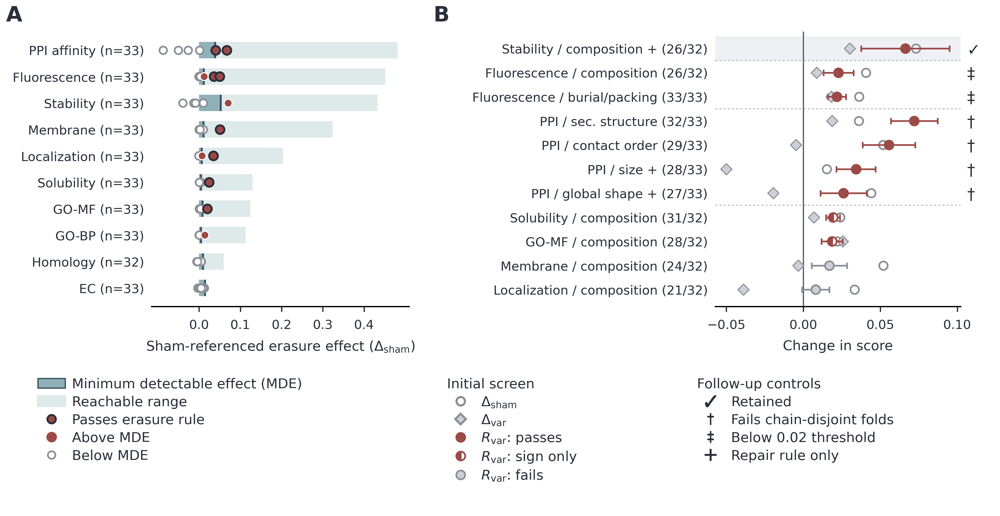
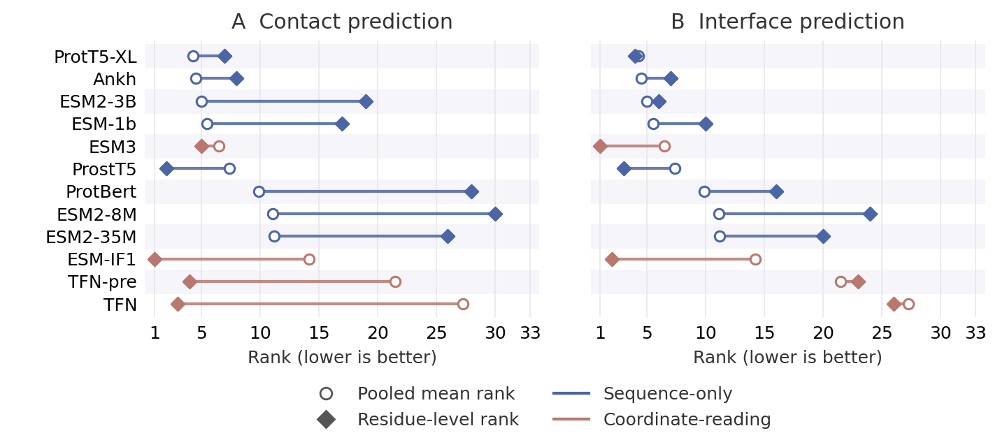
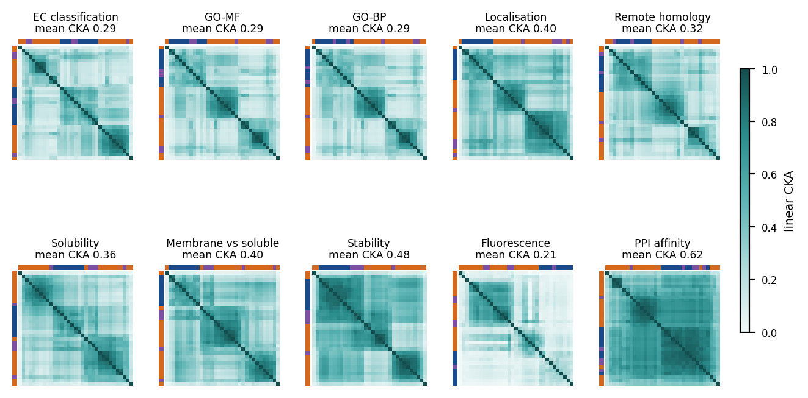

#  ProtCompass: Biological Information and Predictive Utility in Protein Representations

Code, result tables and figures for the ProtCompass benchmark, as described in the manuscript submitted to the
Journal of Chemical Information and Modeling.

<br clear="left"/>

## Overview

Protein encoders are usually evaluated with structural probing, downstream prediction and concept erasure. These
measurements can mix signal the encoder learned with information that is already present in the input or that the
evaluation itself introduces. ProtCompass compares every score with a matched reference that measures what the input
or the intervention alone explains:

- it audits which inputs each encoder actually reads;
- it compares structural probe scores with non-learned descriptors of the same inputs, evaluated with the same probe
  (the **floor**);
- it compares downstream scores with a non-learned reference made of amino-acid composition and length, and with
  group controls for model size, training status and architecture family;
- it controls concept-erasure experiments for the representation capacity removed together with the property, and
  asks whether adding the property back repairs its own erasure.

The release covers 33 encoders, 21 probes and ten downstream tasks. The section
[Reproducing each table and figure](#reproducing-each-table-and-figure) maps every table and figure of the
manuscript and of its Supporting Information (SI) to the script and the result files behind it.

<p align="center">
  
</p>
<p align="center"><em>Figure 1. Overview of ProtCompass: input audit, structural probing against input floors,
downstream prediction against sequence baselines, and erasure with a variance-matched null and add-back repair.</em></p>

## Contents

- [The three analyses](#the-three-analyses)
- [Encoder panel and input audit](#encoder-panel-and-input-audit)
- [Probing labels and downstream tasks](#probing-labels-and-downstream-tasks)
- [Key findings](#key-findings)
- [Confirmation cohorts and held-out tests](#confirmation-cohorts-and-held-out-tests)
- [Latent-space atlas](#latent-space-atlas)
- [Within-model, pretraining, fixed-head and stability controls](#within-model-pretraining-fixed-head-and-stability-controls)
- [Repository layout](#repository-layout)
- [Data and embeddings](#data-and-embeddings)
- [Model weights](#model-weights)
- [Environment](#environment)
- [Quick start](#quick-start)
- [Reproducing each table and figure](#reproducing-each-table-and-figure)
- [Additional tables and figures (not in the manuscript)](#additional-tables-and-figures-not-in-the-manuscript)
- [Earlier version](#earlier-version)

## The three analyses

The code and this README name a few things differently from the manuscript. A *floor* is the score of a non-learned
reference descriptor (the input floor of the manuscript). The *variance-matched null* is the variance-matched control.
The *effect rule* is the sham-referenced selection rule, and *add-back* is the selective repair test. Sequence-only
encoders are the coordinate-insensitive encoders.

### 1. Structural probing against input-matched non-learned floors

- **Data.** CATH 4.3, 19,461 domains and 2,823,525 residues. Domains are split by CATH superfamily into 15,565
  training, 1,948 validation and 1,948 test proteins; a topology-disjoint split is used for confirmation. Residue- and
  pair-level probes are fitted on 3,000 training and 500 validation domains and scored on 1,000 test domains;
  protein-level probes use the full split.
- **Readouts.** All encoders stay frozen. Each probe is read with a linear model and with an MLP-2 (two hidden layers
  of width 128). The readout is selected on validation and evaluated once on test.
- **Floors.** Ten non-learned descriptors are run through the same probes, splits, readouts and seeds: six sequence
  floors (`ref_length`, `ref_position`, `ref_aa`, `ref_seq_window`, `ref_seq_expert`, `ref_seq_global`) and four
  coordinate floors (`ref_coords`, `ref_backbone`, `ref_global`, `ref_pairhist`). Each encoder is compared with the
  floor built from the inputs the audit measures it to read. A cell counts as below the floor when the paired 95%
  confidence interval of the encoder minus floor gap (2,000 paired bootstrap samples of test proteins) lies entirely
  below zero.
- **Label determinacy.** Eleven of the 15 labels in the comparison are determined by the coordinates given to
  structure encoders; for two of these (contact density, contact order) the floor contains the label by construction.
  Relative solvent accessibility, RSA bins and B-factor are not functions of the encoder's input, and fold architecture
  is neither shown to be one nor shown not to be.

Code: `protcompass/scripts/run_probing_suite.py` (probe protocol), `protcompass/scripts/symmetric_run.py` and
`symmetric_decide.py` (one protocol for encoders and floors, and the decision), `protcompass/probing_data/make_probing_data.py`
(labels), `protcompass/scripts/floor_rules.py` (input-matched floors).

### 2. Downstream prediction against a composition-and-length reference and group controls

- Ten scored tasks (listed below). Pooled protein embeddings, readout selected on validation, test score averaged over
  three seeds. Training is capped at 6,000 proteins on eight tasks.
- **Reference.** `ref_composition`, a non-learned descriptor of amino-acid composition and length, is scored like an
  encoder (`protcompass/scripts/make_downstream_reference.py`, `downstream_reference_table.py`).
- **Group controls.** Encoders are grouped by the measured input audit (sequence-only against coordinate-reading), and
  the comparison is repeated by training status, parameter count (at least 100M), architecture family, a common
  116-dimensional projection and 25% or 50% of the training data (`group_controls.py`, `group_controls_multiplicity.py`,
  `fixed_dim_report.py`, `train_size_sweep.py`).

Code: `protcompass/extract/extract.py` (embeddings from audited inputs), `protcompass/extract/score2.py` (scoring),
`protcompass/extract/scores2_*.csv` (results).

### 3. Concept erasure with the effect rule and the add-back repair rule

- Eight protein-level properties are computed for every protein; six independent ones are erased, giving 60
  task-property pairs over ten tasks (charge and hydrophobic fraction are treated as functions of amino-acid
  composition). LEACE removes the linear subspace carrying the property and the downstream head is retrained, so the
  analysis measures linear-head demand.
- **Controls.** A *sham* erasure applies LEACE to a row-permuted copy of the property. A *variance-matched null*
  removes the same share of representation variance from directions that carry little of the property.
- **Effect rule.** For a retrained-head test score S, the erasure effect against a set of control erasures N is
  Δ(N) = mean over E in N of S(EX) − S(E_p X). The rule names a pair when the effect passes a two-sided sign test over
  encoders at Holm-corrected p < 0.05 over the 60 pairs, its mean over encoders is at least 0.02, and the property
  varies on the task.
- **Repair rule.** An independently computed descriptor q of the property is added back to the erased and to the null
  representations: R(N) = [S(E_p X ⊕ q) − S(E_p X)] − mean over E in N of [S(EX ⊕ q) − S(EX)]. A positive contrast
  means q restores more after its own erasure than after a matched control erasure. The repair rule is the effect rule
  with its contrast replaced by R_var and nothing else changed. A row-permuted descriptor is the negative control.

Code: `protcompass/scripts/erasure_v2.py` (erasure grid), `addback_named_pairs.py` (add-back grid),
`named_pair_verdicts.py` (both rules), `exclusion_bounds.py` and `causal_demand_v2.py` (detection bounds);
results in `protcompass/erasure/`.

## Encoder panel and input audit

33 encoders: 9 sequence-based, 19 structure-based and 5 multimodal (declared classes).

| Class | Encoders |
|---|---|
| Sequence (9) | Ankh, ESM-1b, ESM2-8M, ESM2-35M, ESM2-150M, ESM2-650M, ESM2-3B, ProtBert, ProtT5-XL |
| Structure (19) | DimeNet, ESM-IF1, Foldseek (3Di), GCPNet (random and pretrained), GVP, GearNet (random and pretrained), IPA (random and pretrained), MACE, PottsMPNN (random, pretrained, soluble, fine-tuned), ProteinMPNN, SchNet, TFN (random and pretrained) |
| Multimodal (5) | CDConv, ESM3, FoldVision, ProstT5, SaProt |

**Input audit** (`protcompass/extract/input_audit.py`, `atom_audit.py`, `sidechain_audit.py`). The same 32 proteins
are perturbed by swapping or jittering coordinates, shuffling the sequence, and rotating or translating the structure.
Coordinate swapping tests whether an encoder uses coordinates, sequence shuffling whether it uses residue identity,
and rigid-body motion is a sanity check. The audit finds 10 encoders that do not read coordinates and 23 that do.
ProstT5 is declared multimodal and measured sequence-only. EGNN (its embeddings do not change when the coordinates
change), GeoBPE (its output changes under a rigid motion) and dMaSIF (all-zero embeddings) were audited and are not
released. A second audit records which atoms each coordinate-reading encoder uses, so that its floor
is built from the same atoms. Results: `protcompass/extract/encoder_input_audit.csv`, `encoder_atom_audit.csv`,
`encoder_sidechain_audit.csv`; the full panel with checkpoints is `protcompass/paper/generated/encoder_inventory.tex`
(SI Table S1).

## Probing labels and downstream tasks

**Probing suite.** 21 probes in ten protein property groups (PPGs); 15 enter the floor comparison.

| PPG | Probes |
|---|---|
| I1 Local conformation | backbone φ, ψ (circular; 36-bin forms fitted, not compared) |
| I2 Local curvature | local curvature |
| I3 Secondary structure | DSSP-3, DSSP-8 |
| I4 Solvent accessibility | RSA, RSA bins |
| I5 Local flexibility | B-factor |
| I6 Burial and packing | core/surface, contact density |
| I7 Residue contacts | Cα distance bins |
| I8 Global geometry | contact order, radius of gyration, asphericity (length-residualised forms compared) |
| I9 Fold architecture | CATH architecture label |
| I10 Sequence | sequence recovery (fitted, not compared) |

**Downstream tasks.** Fourteen tasks were assembled; four (contact prediction, mutation effect, PPI sites, metal
binding) were excluded after their labels were found unusable as labelled. Ten are scored:

| Task | Metric | Source |
|---|---|---|
| Fluorescence | Spearman ρ | TAPE |
| Stability | Spearman ρ | TAPE |
| Remote homology (fold) | accuracy | TAPE |
| EC classification | accuracy | ProteinWorkshop |
| GO-MF | F-max | ProteinWorkshop |
| GO-BP | F-max | ProteinWorkshop |
| Solubility | AUROC | FLIP |
| PPI affinity (ΔΔG) | Spearman ρ | SKEMPI2 |
| Subcellular localization (10-class) | accuracy | DeepLoc 2 |
| Membrane vs soluble | AUROC | DeepLoc 2 |

Stability, fluorescence, solubility and PPI affinity use ESMFold-predicted structures where experimental structures
are unavailable. Residue-level readouts are tested on two rebuilt tasks: residue-pair contacts and MaSIF interface
residues (`protcompass/contact_task/`, `protcompass/masif_site/`).

## Key findings

Numbers are copied from the manuscript and its Supporting Information (SI). Each paragraph names where they are
reported.

**Structural probing** (Results, "Input Determinacy Changes the Interpretation of Structural Probes"; Table 1 and
Figure 2; SI Section S2).
- Across the 245 coordinate-encoder–label comparisons on determined labels, 231 score below their input-matched
  floor, 3 are unresolved and 11 score above it; none of the 110 sequence-only comparisons falls below its sequence
  floor.
- Removing contact density and contact order, whose floors contain the target: 186 of 200 coordinate comparisons fall
  below the floor, against 0 of 90 sequence-only comparisons.
- A label-agnostic neighbourhood floor (K = 8) gives 131 of 176 against 0 of 80. On the four determined labels with
  weaker floors, 74 of 88 coordinate comparisons fall below, including 35 of 48 pretrained comparisons.
- On labels the input does not determine, encoders beat every written floor on relative solvent accessibility,
  B-factor and fold architecture.

<p align="center"></p>

**Downstream prediction** (Results, "Simple Sequence References Clarify Downstream Predictive Value"; Figure 3; SI
Section S3).
- Sequence-only encoders achieve higher mean performance on all ten tasks. The advantage ranges from 0.090 to 0.473
  on nine tasks, with a mean gap of 0.186 across the panel; eight of these task-level differences remain significant
  after Holm correction. On PPI affinity the gap is 0.011, against a mean seed standard deviation of 0.101.
- Restricted to pretrained models with at least 100M parameters (eight sequence-only, four coordinate-reading),
  sequence-only models score higher on eight of ten tasks, and the average gap shrinks to 0.048 and is not resolved
  across architecture families (+0.049 [−0.016, +0.114]; permutation p = 0.093).
- The composition-and-length reference comes within 0.02 of the median encoder on solubility, GO-BP, localization and
  fluorescence. On these four tasks the best encoder exceeds it by 0.119–0.235, and the median of the eight pretrained
  sequence encoders with at least 100M parameters exceeds it by 0.103–0.205.
- Median seed standard deviation of the downstream cells: 0.0059.

<p align="center"></p>

**Concept erasure** (Results, "Variance-Matched Erasure Identifies Selective Property Dependence"; Figure 4; SI
Section S4).
- LEACE lowers the linear readout of the erased property from a median 0.669 to −0.003; nonlinear readouts keep much
  of it. Synthetic tests recover a property that is used and give effects within ±0.007 when it is not.
- Against the sham, eight task–property pairs show a consistent drop, but the real erasure removes a median 3.6× more
  representation variance than the sham. Against the variance-matched null, two of the eight remain consistent, and
  one of these does not reproduce on held-out proteins. The variance match is within 1% on 62% of audited cells and
  within 5% on 84%.
- Over 60 task–property pairs the repair rule names seven candidates: four on PPI affinity, two on fluorescence, and
  amino-acid composition on stability.
- The four PPI signals disappear when training and test share no protein chains. On fluorescence, simple mutation
  statistics alone reach Spearman ρ = 0.49; with them included, the repairs for composition and burial/packing fall to
  +0.004 and +0.0003.
- Composition on stability remains: with the same competing features it restores +0.100 and is positive for 30 of 32
  encoders; a kernel-based intervention gives +0.085 on 32 of 33 encoders. The composition of the parent protein carries
  the signal (+0.085 on 29 of 32 encoders); the composition change introduced by the mutation does not (+0.002).

<p align="center"></p>

**Rankings across prediction levels** (Results, "Simple Sequence References Clarify Downstream Predictive Value";
Supplementary Fig. S1; SI Section S6). On residue-pair contacts, coordinate-reading and
sequence-only encoders perform similarly on average (AUPRC 0.263 against 0.247, one-sided Mann–Whitney p = 0.35), and
an encoder's contact rank is only weakly related to its rank on the ten pooled tasks (ρ = 0.22). The pooled ranking
transfers to interface-residue prediction (ρ = 0.73).

<p align="center"></p>

**Robustness** (SI Sections S2.6, S3.6 and S4.8). After projecting all representations to 116 dimensions, the mean sequence-only lead on the
downstream tasks is 0.164, against 0.186 at native widths. Keeping the vector channels of four equivariant encoders
raises their probe scores, and all 44 determined encoder–label comparisons stay below their input floors. With a
nonlinear head the stability composition signal is positive on 7 of 12 encoders.

## Confirmation cohorts and held-out tests

(Results, "Input Determinacy Changes the Interpretation of Structural Probes" and "Variance-Matched Erasure Identifies
Selective Property Dependence"; SI Section S5, Tables S26 to S33.)

- **Unseen CATH topologies.** On 1,924 domains from unseen CATH topologies, 234 of 245 coordinate cells remain below
  their floor and no sequence-only cell does; undetermined labels show larger margins by +0.178 [+0.146, +0.217].
  The hypotheses were frozen before scoring (`protcompass/symmetric/freeze_topology.json` and its sha256).
- **Pre-registered new labels.** On three new labels whose determinacy and floors were fixed before scoring, every
  determined family falls below its floor and undetermined families shift upward by +0.136 [+0.081, +0.188]
  (`protcompass/prereg/freeze.json`, `freeze.sha256.json`, `decision.json`, `decision_cohortB.json`,
  `POST_FREEZE_LOG.md`).
- **Two CATH 4.4 cohorts** of domains absent from CATH 4.3 (`protcompass/confirmation/`, `protcompass/confirmation2/`).
  The sequence-only and undetermined-label predictions hold in both; two predictions on individual encoders fail.
- **Downstream held-out proteins.** Previously unscored proteins, with the fitting and scoring rules frozen before
  evaluation (`protcompass/confirmation_downstream/freeze.json`). Selective repair holds on these proteins, while the
  variance-matched erasure effect can lose its consistency in sign. Paired protein bootstraps quantify uncertainty,
  and multi-output readouts complete the four tasks that need larger heads.

## Latent-space atlas

The atlas is released with this repository and is not part of the manuscript or its Supporting Information.

The atlas maps where every encoder places the proteins of each scored task, one layer per task (about 2,000 proteins
per layer, stratified by class, seed 42), for all 33 encoders (32 on remote homology). Each embedding is mean-pooled,
reduced by UMAP (k = 10, seed 42) and Procrustes-aligned to ESM2-150M. Encoders are compared by debiased linear CKA and
k-nearest-neighbour overlap on the full embeddings, and each panel is scored by 10-NN label purity.

- On all ten task layers the encoder whose ten nearest neighbours most often share a protein's label reads sequence
  only.
- Neighbourhood purity against chance detects all four failures in a discarded embedding cache (all-zero dMaSIF
  embeddings, a collapsed PottsMPNN checkpoint, an incomplete IPA entry, and an unseeded GCPNet wrapper).

Files: `protcompass/scripts/build_atlas_v4.py` (build), `make_atlas_figures_paper.py` (figures),
`emit_atlas_summary.py` (summary table); `protcompass/atlas/data_v4/summary.json`; the atlas data
`protcompass/atlas/data_v4/atlas.json` (28 MB) is on Hugging Face; figures in `figures/atlas/`.

<p align="center"></p>

## Within-model, pretraining, fixed-head and stability controls

Each of these analyses has a pre-specification written before scoring (`PRESPEC.md` and its sha256 in the listed
folder). Some of the released copies differ from the originals in a few lines (a local path, notes on how the work was
organised, and pointers to working notes that are not released); `protcompass/PRESPEC_REDACTIONS.md` lists every
changed line. The `.sha256` files are the checksums recorded before scoring and refer to the unedited originals.

- **Within-model modality ablation** (SI Section S3.4, Tables S11 and S12; `protcompass/extract/ab_modality/`). ESM3 is run with the true sequence and no
  structure, and SaProt with every 3Di token replaced by `#`. The structure input raises fold recognition for both
  models (ESM3 +0.055, SaProt +0.117) and lowers fluorescence for both (ESM3 −0.119, SaProt −0.136). Removing the
  structure input lowers the probe score on 29 of the 30 cells; with the structure input SaProt is below the floor of
  its atoms on all eleven determined labels and ESM3 on eight, and with the same weights and the sequence only both are
  above the sequence floors on all eleven.
- **Shuffled-3Di control for SaProt.** A third source keeps each protein's own 3Di tokens and permutes their positions.
  The full model scores above the shuffled one on all ten tasks (+0.069 to +0.458) and all fifteen probes, and the
  shuffled model scores below the `#` model on eight tasks and twelve probes (`*_shuf.csv`, `table_shuf3di*.tex`).
- **Random against pretrained pairs** (SI Section S2.6; `protcompass/symmetric/ab_train_pairs/`). Over five architectures present in
  both states (GCPNet, GearNet, IPA, TFN, PottsMPNN), 38 of the 75 probe cells rise with pretraining, 29 fall and 8 are
  unresolved; 54 of the 55 determined cells of the random versions and 53 of the 55 of the pretrained versions are
  below the floor.
- **Fixed-head erasure** (SI Section S4.5, Table S22; `protcompass/erasure/ab_fixed_head/`). A head fitted once on the intact representation is
  scored on erased inputs. The fixed-head rule names three pairs: burial and packing on fluorescence (+0.056, 33 of 33
  encoders), composition on fluorescence (+0.031, 26 of 32) and composition on solubility (+0.021, 30 of 32).
  Composition on stability has a positive mean (+0.047) but is positive on 21 of 32 encoders (Holm p = 0.22).
- **Stability composition decomposition** (SI Section S4.7, Table S24; `protcompass/erasure/ab_stability_decomp/`). The composition descriptor is
  split exactly into the parent background and the substitution vector. The repair is carried by the parent
  background (+0.085 on 29 of 32 encoders and 19 of 20 families with the wild-type and mutant residues and the site
  environment in every arm); the substitution vector repairs nothing (+0.003 with the released competitors, +0.002
  with the larger set).

## Repository layout

| Path | Contents |
|---|---|
| `protcompass/scripts/` | analysis, table and figure scripts of the manuscript |
| `protcompass/extract/` | extraction harness (`common.py`, `extract.py`, `input_audit.py`, `patched/` wrappers), scoring (`score2.py`), manifests, downstream scores (`scores2_*.csv`), audits, the modality ablation (`ab_modality/`) and the `meta.json` of every released embedding |
| `protcompass/src/` | encoder wrappers imported by the extraction harness (`from src.models import get_encoder`) |
| `protcompass/probing_data/` | probing label builder, dataset reader, splits, schema |
| `protcompass/probing_results*/`, `protcompass/symmetric/` | probing scores of encoders and floors, and the floor comparison |
| `protcompass/erasure/` | erasure and add-back grids, rules, controls |
| `protcompass/confirmation*/`, `protcompass/prereg/` | confirmation cohorts, frozen hypotheses and decisions |
| `protcompass/contact_task/`, `protcompass/masif_site/` | residue-pair and residue-level tasks |
| `protcompass/atlas/` | latent-space atlas summary |
| `protcompass/qd/leace_check/` | comparison of the eraser with the reference LEACE implementation |
| `protcompass/qd/gfp_competing/`, `protcompass/qd/stability_competing/` | pre-specifications of the competing-explanation panels on fluorescence and stability |
| `protcompass/PRESPEC_REDACTIONS.md` | every line of a released pre-specification that differs from the original |
| `protcompass/audit/` | inputs and results of the withdrawn correlational analysis |
| `protcompass/paper/generated/` | the LaTeX tables as the scripts emit them; the tables of the manuscript and of its Supporting Information report these numbers in their own layout |
| `protcompass/paper/figures/` | the scripts of the earlier figure layout write here |
| `figures/` | the figures of the manuscript (written by `protcompass/scripts/make_figures_unified.py`) and the other figures shown in this README |
| `src/`, `scripts/`, `downstream_tasks/`, `reproduction_package/`, `environment.yml` | earlier version (see [Earlier version](#earlier-version)) |

All paths inside the released code are relative to one root, read from the environment variable `PROTCOMPASS_ROOT`.
It defaults to the repository root, so no setting is needed when the scripts are run from a clone. Large inputs
downloaded from Hugging Face go to the same relative paths under `protcompass/`. Third-party encoder code is expected
under `protcompass/external_repos/` and checkpoints under `protcompass/checkpoints/` (see [Model weights](#model-weights)).
Scripts that start a worker in
another conda environment look for it under `~/miniconda3/envs/<name>/`.

## Data and embeddings

Files larger than 5 MB, embeddings and label files are in the Hugging Face repository
[Anonymoususer2223/ProtCompass_Embeddings](https://huggingface.co/Anonymoususer2223/ProtCompass_Embeddings) (a model
repository), part of the collection [huggingface.co/collections/Anonymoususer2223/](https://huggingface.co/collections/Anonymoususer2223/).
Its files sit at the repository root and mirror `protcompass/`: the Hugging Face path `<x>` is `protcompass/<x>` here.
Downloading into `protcompass/` therefore puts every file where the scripts look:

```bash
pip install -U huggingface_hub
cd ProtCompass
# one folder, for example the downstream embeddings of one task
huggingface-cli download Anonymoususer2223/ProtCompass_Embeddings \
    --include "extract/embeddings/stability/*" --local-dir protcompass
# the task manifests and the probing labels
huggingface-cli download Anonymoususer2223/ProtCompass_Embeddings \
    --include "extract/manifest/*" "probing_data/*" --local-dir protcompass
```

The same repository also holds, under `embeddings/` and `probing_IF/`, the files of the earlier version of the
benchmark; the manuscript does not use them.

| Hugging Face path (= path under `protcompass/`) | Contents | Size |
|---|---|---|
| `extract/embeddings/<task>/<encoder>/` | pooled embeddings (`train/valid/test.npy`, `ids_*.txt`, `meta.json`) of the 33 encoders and the composition reference on the ten tasks | 6.5 GB |
| `extract/manifest/*.csv` | task manifests: id, split, sequence, structure file, label (the three smaller ones are also in this repository) | 0.12 GB |
| `extract/pairs/ppi_affinity_pairs.csv`, `extract/encoder_input_audit.csv`, `encoder_atom_audit.csv`, `encoder_sidechain_audit.csv` | PPI pairs and input audit (also in this repository) | <0.01 GB |
| `probing_embeddings/<encoder>/` | per-residue and pooled embeddings of the 33 encoders on the 19,461 CATH 4.3 domains | 96.9 GB |
| `probing_embeddings_vframe/` | GVP, GCPNet and MACE with the direction of their vector channels kept | 5.2 GB |
| `probing_data/labels.h5`, `probing_data/splits/` | probe labels, coordinates and splits | 0.32 GB |
| `extract/ab_modality/embeddings/`, `extract/ab_modality/probing_embeddings/` | ESM3 and SaProt without structure input, and SaProt with shuffled 3Di tokens | 1.5 GB, 23.5 GB |
| `confirmation/`, `confirmation2/` | the two CATH 4.4 probing cohorts (`labels_v44.h5`, `cohort_manifest.csv`, embeddings) | 3.7 GB, 2.6 GB |
| `confirmation_downstream/` | held-out downstream proteins (cohort lists and embeddings) | 0.54 GB |
| `masif_site/` | residue-level interface task (`labels.h5`, exclusions, summary, embeddings) | 20.2 GB |
| `atlas/data_v4/*.json` | latent-space atlas data, including `atlas.json` | 0.06 GB |
| `checkpoints/<encoder>/<file>` | pretrained checkpoints of six structure encoders (see [Model weights](#model-weights)) | 0.16 GB |

**Structures.** The manifests give the structure file each row was extracted from (`structure_path`). The
ESMFold structures of stability, fluorescence, solubility and PPI affinity are in the dataset
[Anonymoususer2223/ProtEnv](https://huggingface.co/datasets/Anonymoususer2223/ProtEnv) under `predicted_structures/`.
The experimental (PDB), AlphaFold DB, SCOPe and CATH structures are public and are not redistributed;
`structures/fetch_structures.py` and `probing_data/make_probing_data.py` fetch them.

**Files that are not uploaded.** Intermediate files that the scripts write while they run are not in the Hugging Face
repository. The summary tables built from them are in this repository, so every table of the manuscript can be
regenerated without them. A released script rebuilds each of them:

| Path under `protcompass/` | Regenerated by |
|---|---|
| `extract/cache/` (parsed coordinates) | `extract/prepare_caches.py` (also on first use by `extract/extract.py`) |
| `symmetric/results_*/by_source/*__test_predictions.npz`, `symmetric/nbr_cache_*` | `scripts/symmetric_run.py` |
| `prereg/results*/by_source/*.npz` | `scripts/prereg_run.py` |
| `prereg/labels_*.h5` | `scripts/prereg_labels.py`, `scripts/prereg_merge_cohortB.py` |
| `confirmation/merged/`, `confirmation2/merged/` | `scripts/confirmation_merge.py` |
| `confirmation_downstream/predictions/*.npz` | `scripts/addback_holdout.py` |
| `confirmation_downstream/bighead_matched/*.npz` | `scripts/bighead_holdout.py` |
| `erasure/concepts/*.npz` (the fluorescence and PPI-affinity caches are in this repository) | `scripts/common_struct.py` |
| `erasure/ab_stability_decomp/descriptors.csv` | `scripts/ab_stability_decomp.py` |

## Model weights

The code reads the pretrained checkpoints of six structure encoders from fixed paths (these paths are not changed for
the release): `protcompass/checkpoints/proteinmpnn_v48_020.pt`, `protcompass/checkpoints/gearnet/mc_gearnet_edge.pth`,
`protcompass/external_repos/GCPNet/checkpoints/PSR/` and `protcompass/external_repos/PottsMPNN/...`. The files are in
the `checkpoints/` folder of the Hugging Face repository
[Anonymoususer2223/ProtCompass_Embeddings](https://huggingface.co/Anonymoususer2223/ProtCompass_Embeddings), one
folder per encoder (`checkpoints/<encoder>/<file>`), with the upstream licence of each file and `SHA256SUMS`.
`checkpoints/README.md` in that repository has a script that links the downloaded files to the paths the code reads.

```bash
huggingface-cli download Anonymoususer2223/ProtCompass_Embeddings --include "checkpoints/*" --local-dir hf_weights
(cd hf_weights/checkpoints && sha256sum -c SHA256SUMS)
# then run the link script in hf_weights/checkpoints/README.md from the root of this repository
```

| Encoder | Hugging Face file | Path the code reads |
|---|---|---|
| ProteinMPNN | `checkpoints/proteinmpnn/proteinmpnn_v48_020.pt` | `protcompass/checkpoints/proteinmpnn_v48_020.pt` |
| GearNet (pretrained) | `checkpoints/gearnet_pretrained/mc_gearnet_edge.pth` | `protcompass/checkpoints/gearnet/mc_gearnet_edge.pth` |
| GCPNet (pretrained) | `checkpoints/gcpnet_pretrained/<file>.ckpt` | `protcompass/external_repos/GCPNet/checkpoints/PSR/<file>.ckpt` |
| PottsMPNN (pretrained) | `checkpoints/pottsmpnn_pretrained/pottsmpnn_20.pt` | `protcompass/external_repos/PottsMPNN/proteinmpnn_compatible_model_weights/pottsmpnn_20.pt` |
| PottsMPNN (soluble) | `checkpoints/pottsmpnn_soluble/sol_pottsmpnn_20.pt` | `protcompass/external_repos/PottsMPNN/soluble_model_weights/sol_pottsmpnn_20.pt` |
| PottsMPNN (fine-tuned) | `checkpoints/pottsmpnn_ft/potts_ft.pt` | `protcompass/external_repos/PottsMPNN/ft_model_weights/potts_ft.pt` |

The TFN-pre and IPA-pre weights (read from `protcompass/checkpoints/tfn_pretrained/best.pt` and
`protcompass/checkpoints/ipa_pretrained/best.pt`) were taken from the models' released repositories and are not
redistributed here.

The sequence and multimodal models (ESM-1b, ESM2, ProtBert, ProtT5, Ankh, ProstT5, SaProt, FoldVision) load from the
Hugging Face hub, ESM-IF1 through `torch.hub` from the ESM release, and Foldseek 3Di states are computed by the
`mini3di` package. The exact identifiers and revisions are in `protcompass/paper/generated/encoder_inventory.tex` and in
each `meta.json`.

ESM3 weights (`esm3-sm-open-v1`) are not redistributed. Obtain them from EvolutionaryScale under their licence (the
gated Hugging Face repository `EvolutionaryScale/esm3-sm-open-v1`) and place them at `protcompass/esm3-sm-open-v1/`;
the code reads `protcompass/esm3-sm-open-v1/data/weights/esm3_sm_open_v1.pth`.

## Environment

- `protcompass/ENVIRONMENT.md` records the computational environment of the release.
- `protcompass/environment_protein_embeddings_20260925.yml` is the full conda export and
  `protcompass/requirements_lock_protein_embeddings_20260925.txt` the pip lock.
- Main environment: Python 3.10.20, NumPy 1.26.4, SciPy 1.15.3, scikit-learn 1.7.2, pandas 2.3.3, PyTorch 2.11.0
  (CUDA 13.0), transformers 4.46.3, on an NVIDIA RTX 5090.
- Four SaProt embedding sets of the modality ablation were computed on a second GPU machine with a CUDA 12.8 build of
  PyTorch 2.11 (2.11.0+cu128) and the same NumPy, SciPy, scikit-learn, pandas and transformers versions; they agree with
  a local recomputation to a relative 3.3e-7. Part of the repair-grid shards also ran on a second machine; see
  `ENVIRONMENT.md` for the affected outputs.
- The original runs put a local pip install of sentencepiece 0.2.2 on `PYTHONPATH`; install `sentencepiece==0.2.2`
  instead.

```bash
conda env create -f protcompass/environment_protein_embeddings_20260925.yml
conda activate protein_embeddings
```

## Quick start

The table and figure scripts run from the files in this repository, except the few marked "Hugging Face" in the
index below. Run them from `protcompass/`:

```bash
git clone <this repository> ProtCompass && cd ProtCompass/protcompass
# optional: export PROTCOMPASS_ROOT=/path/to/ProtCompass   (defaults to the repository root)

# Tables, printed as LaTeX
python scripts/emit_downstream_table.py scores          # full downstream table (33 x 10; SI Table S16)
python scripts/emit_latex_tables.py downstream-reference # composition-and-length reference (SI Table S10)
# repair rule over the 60 task-property pairs (SI Table S21 lists the seven pairs it names)
python scripts/named_pair_verdicts.py --tag full --latex \
    --src erasure/named_pairs_full erasure/named_pairs_full_remote erasure/named_pairs_full_remote_partial
# probing counts by label group (Table 1)
python scripts/headline_reanalysis.py --latex /tmp/headline.tex --latex-atoms /tmp/atoms.tex

# Figures 2 to 4 and Supplementary Fig. S1 as in the manuscript, written to figures/
python scripts/make_figures_unified.py

# The same figures in an earlier layout, written to protcompass/paper/figures/
python scripts/make_figures_paper.py        # Figures 3 and 4 (also an older Figure 2 layout)
python scripts/make_figure2_symmetric.py    # Figure 2; run after make_figures_paper.py
python scripts/make_figure2_radars_sixfloors.py
python paper/scripts/plot_residue_rankings.py
```

Scripts that fit probes, extract embeddings or run the erasure grids need the embeddings, structures and labels from
Hugging Face and a GPU for extraction. The extraction also needs the third-party encoder repositories under
`protcompass/external_repos/` and the checkpoints under `protcompass/checkpoints/`.

## Reproducing each table and figure

The tables below follow the order of the manuscript and of its Supporting Information (SI). SI sections are numbered
S1 to S6 (the main text cites them as Supplementary Notes), SI tables S1 to S36, and the SI figure S1. Paths are
relative to `protcompass/`, except paths that start with `figures/`, which are in the top-level `figures/` folder.
"repo" means every listed file is in this repository; "Hugging Face" means at least one listed file is in the
embeddings repository (see [Data and embeddings](#data-and-embeddings)). `paper/generated/*.tex` are the tables as
the scripts emit them; the SI tables report the same numbers in their own layout, and some show a subset of the
rows. A "Text" row is a statement in the text whose numbers come from the listed files.

**Main text**

| Where in the manuscript | Table, figure or statement | Script(s) | Result file(s) | Location |
|---|---|---|---|---|
| Introduction | Figure 1: Overview of ProtCompass | – | `figures/Figure1.png` | repo |
| Results, "Input Determinacy Changes the Interpretation of Structural Probes" | Figure 2: Structural probe scores depend on the information available to the encoder | `scripts/make_figures_unified.py`, `scripts/make_figure2_symmetric.py`, `scripts/make_panels_original_style.py` | `symmetric/results_superfamily/by_source/*.csv`, `extract/encoder_input_audit.csv`, `probing_results/floor_assignment.csv`, `symmetric/figure2_symmetric_values.csv`, `figures/Figure2.png` | repo |
| Results, "Input Determinacy Changes the Interpretation of Structural Probes" | Table 1: Structural probing against input-matched reference floors | `scripts/symmetric_run.py`, `scripts/symmetric_decide.py`, `scripts/headline_reanalysis.py` | `symmetric/cells_superfamily.csv`, `symmetric/counts_superfamily.csv`, `symmetric/cells_topology.csv`, `symmetric/counts_topology.csv`, `symmetric/headline_reanalysis.json`, `symmetric/hypotheses_superfamily.json` | repo |
| Results, "Simple Sequence References Clarify Downstream Predictive Value" | Figure 3: Downstream predictive performance of 33 protein encoders across ten biological tasks | `scripts/make_figures_unified.py`, `scripts/make_panels_original_style.py`, `extract/score2.py` | `extract/scores2_wide.csv`, `extract/scores2_selected.csv`, `extract/encoder_input_audit.csv`, `figures/Figure3.png` | repo |
| Results, "Variance-Matched Erasure Identifies Selective Property Dependence" | Figure 4: Variance-matched controls and selective repair refine evidence for task-specific property dependence | `scripts/make_figures_unified.py`, `scripts/exclusion_bounds.py`, `scripts/named_pair_verdicts.py`, `scripts/erasure_v2.py`, `scripts/addback_named_pairs.py` | `erasure/parts/erasure_v2_*.csv`, `erasure/parts/erasure_control_*.csv`, `erasure/named_pair_verdicts_full.csv`, `erasure/named_pair_cells_full.csv`, `figures/Figure4.png` | repo |

**SI Section S1: Encoder Panel and Input Audit**

| Where in the manuscript | Table, figure or statement | Script(s) | Result file(s) | Location |
|---|---|---|---|---|
| S1.1 | Table S1: Evaluated encoder panel (the same script emits the probe inventory behind Table S3) | `scripts/emit_inventory.py` | `extract/encoder_input_audit.csv`, `extract/scores2_selected.csv`, `extract/embeddings/stability/*/meta.json`, `probing_results/floor_vs_encoders.csv`, `probing_results/by_source/esm2_650m.csv`, `paper/generated/probe_inventory.tex`, `paper/generated/encoder_inventory.tex` | repo |
| S1.1, S1.3, S1.4 | Text: Encoder panel, input audit and excluded implementations | `extract/input_audit.py` | `extract/encoder_input_audit.csv`, `extract/scores2_long.csv` | repo |
| S1.2 | Text: Encoder read-out rules | `extract/common.py` | `extract/embeddings/*/*/meta.json` | repo |
| S1.3 | Table S2: Atom inputs detected among the 23 coordinate-reading encoders | `extract/atom_audit.py`, `scripts/floor_rules.py` | `probing_results/floor_admissibility.csv`, `probing_results_atom/by_source/*.csv`, `probing_results_val/by_source/*.csv`, `probing_results_atom_val/by_source/*.csv`, `extract/encoder_atom_audit.csv`, `paper/generated/floor_admissibility.tex`, `paper/generated/floor_rules_counts.tex` | repo |

**SI Section S2: Structural Probing and Input-Matched References**

| Where in the manuscript | Table, figure or statement | Script(s) | Result file(s) | Location |
|---|---|---|---|---|
| S2.1 | Text: Probe labels and splits | `probing_data/make_probing_data.py`, `probing_data/probing_dataset.py` | `probing_data/labels.h5`, `probing_results/protocol.json`, `probing_data/splits/*`, `probing_data/schema.md` | repo; Hugging Face |
| S2.1 | Text: Probe pipeline protocol | `scripts/run_probing_suite.py`, `scripts/probing_io.py` | `probing_results/protocol.json` | repo |
| S2.1 | Table S3: Probing labels included in the matched-floor analysis | `probing_data/make_probing_data.py` | `probing_data/schema.md` | repo |
| S2.1 | Text: B-factor label definition (Table S3) | `probing_data/make_probing_data.py` | – | script only |
| S2.2 | Table S4: Non-learned references used in structural probing | `scripts/emit_floor_definitions.py`, `scripts/precompute_floor_protein_features.py` | `probing_results/by_source/ref_*.csv`, `paper/generated/floor_definitions.tex` | repo |
| S2.3 | Table S5: Sensitivity of point-estimate floor counts to eligibility and reference selection | `scripts/floor_rules.py`, `scripts/floor_rules_readout_bound.py` | `probing_results/floor_rules_counts.csv`, `probing_results/floor_rules_cells.csv`, `probing_results/floor_rules_readout_bound.csv` | repo |
| S2.4 | Text: Numerical check of the determined labels | `scripts/check_label_determinacy.py`, `scripts/emit_label_determinacy.py` | `probing_results/label_determinacy.csv`, `probing_data/labels.h5` | repo; Hugging Face |
| S2.4 | Text: Numerical check of the determined labels | `scripts/check_label_determinacy.py`, `scripts/emit_label_determinacy.py` | `probing_results/label_determinacy.csv`, `paper/generated/label_determinacy.tex` | repo |
| S2.4 | Text: Status of each label (determined, undetermined, not established), with the floor it is read against and the best encoder | `scripts/determinacy_table.py` | `probing_results/floor_vs_encoders.csv`, `probing_results/determinacy_table.csv`, `paper/generated/determinacy.tex` | repo |
| S2.5 | Table S6: Confidence-qualified gaps on determined labels | `scripts/symmetric_run.py`, `scripts/symmetric_decide.py`, `scripts/symmetric_latex.py` | `symmetric/cells_superfamily.csv`, `symmetric/counts_superfamily.csv`, `paper/generated/symmetric_counts.tex` | repo |
| S2.5 | Text: Counts by label and encoder | `probing_data/make_probing_data.py`, `extract/atom_audit.py` | `symmetric/cells_superfamily.csv`, `extract/encoder_atom_audit.csv`, `paper/generated/encoder_inventory.tex` | repo |
| S2.5; Table 1 | Text: Counts on the nine determined labels no floor contains and on the four labels with weaker floors | `scripts/headline_reanalysis.py` | `symmetric/headline_counts_by_saturation.csv`, `symmetric/gap_regression.csv`, `symmetric/undetermined_without_esm3.csv`, `symmetric/headline_reanalysis.json`, `paper/generated/headline_atoms.tex`, `paper/generated/headline_reanalysis.tex` | repo |
| S2.6 | Text: Pretraining within an architecture (the table and the figure are released here) | `scripts/ab_train_pairs.py`, `scripts/ab_train_pairs_report.py` | `symmetric/ab_train_pairs/probing_cells.csv`, `symmetric/ab_train_pairs/probing_summary.csv`, `symmetric/ab_train_pairs/downstream.csv`, `symmetric/ab_train_pairs/downstream_summary.csv`, `symmetric/ab_train_pairs/PRESPEC.md`, `symmetric/ab_train_pairs/PRESPEC.sha256`, `symmetric/ab_train_pairs/train_pairs.tex`, `symmetric/ab_train_pairs/train_pairs_matrix.tex`, `symmetric/ab_train_pairs/train_pairs_downstream.tex`, `paper/generated/train_pairs.tex`, `figures/train_pairs.png` | repo; partly working notes (not released) |
| S2.6 | Text: Retaining equivariant vector directions | `scripts/vframe_compare.py`, `extract/extract_vector_frame.py` | `symmetric/vframe_superfamily.csv` | repo |
| S2.6 | Text: Equalizing dimensionality (every source projected to 116 dimensions) | `scripts/emit_matched_capacity_table.py` | `probing_results/by_source_k116/*.csv`, `probing_results/floor_assignment.csv`, `paper/generated/matched_capacity.tex` | repo |
| S2.6 | Text: Control-task selectivity on DSSP-3 | `scripts/symmetric_decide.py`, `scripts/symmetric_latex.py` | `symmetric/selectivity_superfamily.csv`, `paper/generated/symmetric_selectivity.tex` | repo |
| S2.6, S2.7 | Table S7: Fold-architecture balanced accuracy on eleven shared CATH architectures; Text: sequence-alignment reference | `scripts/emit_latex_tables.py`, `scripts/architecture_all_floors.py`, `scripts/architecture_alignment_floor.py`, `scripts/sequence_alignment_floor.py`, `scripts/pairhist_floor.py` | `probing_results/architecture_all_floors.csv`, `probing_results/architecture_strong_floors_*.csv`, `probing_results/sequence_alignment_floor.csv`, `paper/generated/strong_floors.tex` | repo |

**SI Section S3: Downstream Prediction and Sequence Baselines**

| Where in the manuscript | Table, figure or statement | Script(s) | Result file(s) | Location |
|---|---|---|---|---|
| S3.1 | Table S8: Ten scored downstream tasks; Table S9: Data partitions and structure sources | `extract/build_manifests.py`, `extract/build_manifests2.py` | `extract/manifest/*.csv`, `extract/pairs/ppi_affinity_pairs.csv` | repo; Hugging Face |
| S3.1 | Text: Downstream label counts | `extract/score2.py`, `extract/build_manifests2.py` | `extract/manifest/*.csv` | repo; Hugging Face |
| S3.1, S6.1 | Text: The four excluded tasks | – | `extract/manifest/*.csv` | repo; Hugging Face; partly working notes (not released) |
| S3.2 | Text: Downstream protocol and panel | `extract/score2.py` | `extract/scores2_long.csv`, `extract/scores2_wide.csv`, `extract/scores2_selected.csv`, `extract/scores2_missing.csv`, `extract/encoder_input_audit.csv` | repo; partly working notes (not released) |
| S3.3 | Table S10: Downstream performance relative to amino-acid composition and length | `scripts/headline_reanalysis.py` | `symmetric/headline_reanalysis.json` | repo |
| S3.3 | Table S10: Downstream performance relative to amino-acid composition and length | `scripts/emit_latex_tables.py`, `scripts/downstream_reference_table.py`, `scripts/make_downstream_reference.py` | `extract/scores2_selected.csv`, `paper/generated/downstream_reference.tex` | repo |
| S3.4 | Table S11: Effect of structure input within a fixed checkpoint; Table S12: SaProt control with shuffled structure tokens; Text: the same ablation on the structural probes | `extract/ab_modality/ab_extract.py`, `extract/ab_modality/ab_score.py`, `extract/ab_modality/ab_bootstrap.py`, `extract/ab_modality/ab_symmetric_run.py`, `extract/ab_modality/ab_probe_decide.py`, `extract/ab_modality/ab_latex.py`, `extract/ab_modality/ab_shuf_extract.py`, `extract/ab_modality/ab_shuf_score.py`, `extract/ab_modality/ab_shuf_bootstrap.py`, `extract/ab_modality/ab_shuf_symmetric_run.py`, `extract/ab_modality/ab_shuf_probe_decide.py`, `extract/ab_modality/ab_shuf_latex.py`, `extract/ab_modality/ab_shuf_probing.sh`, `extract/ab_modality/finish_pipeline.sh`, `extract/patched/esm3_seqonly.py`, `extract/patched/saprot_seqonly.py`, `extract/patched/saprot_shuf3di.py` | `extract/ab_modality/downstream_deltas.csv`, `extract/ab_modality/probing_deltas.csv`, `extract/ab_modality/probing_floor_cells.csv`, `extract/ab_modality/downstream_deltas_shuf.csv`, `extract/ab_modality/probing_deltas_shuf.csv`, `extract/ab_modality/PRESPEC.md`, `extract/ab_modality/PRESPEC.sha256`, `extract/ab_modality/PRESPEC_shuf.md`, `extract/ab_modality/PRESPEC_shuf.sha256`, `extract/ab_modality/*shuf*.csv`, `extract/ab_modality/downstream_group_summary.csv`, `extract/ab_modality/scores_ab_long.csv`, `extract/ab_modality/scores_ab_selected.csv`, `extract/ab_modality/refit_check.csv`, `extract/ab_modality/encoder_input_audit_ab.csv`, `paper/generated/modality_downstream.tex`, `paper/generated/modality_probing.tex`, `paper/generated/modality_shuf3di.tex`, `paper/generated/modality_shuf3di_probing.tex`, `paper/generated/modality_shuf3di_merged.tex`, `extract/ab_modality/table_*.tex` | repo; partly working notes (not released) |
| S3.5 | Text: Confounds of the comparison | – | `extract/scores2_selected.csv`, `extract/scores2_long.csv` | repo |
| S3.5 | Text: Grouping by input audit | – | `extract/scores2_wide.csv`, `extract/encoder_input_audit.csv` | repo |
| S3.5 | Tables S13 and S14: Sequence-only minus coordinate-reading performance under nested restrictions, and additional group-comparison diagnostics | `scripts/group_controls.py` | `extract/scores2_selected.csv` | repo |
| S3.5 | Tables S13 and S14 (as above) | `scripts/headline_reanalysis.py` | `symmetric/headline_reanalysis.json` | repo |
| S3.5 | Tables S13 and S14 (as above) | `scripts/emit_latex_tables.py`, `scripts/group_controls.py` | `extract/scores2_selected.csv`, `extract/encoder_input_audit.csv`, `extract/embeddings/stability/*/meta.json`, `paper/generated/group_controls.tex` | repo |
| S3.5 | Tables S13 and S14 (as above) | `scripts/emit_group_controls_merged.py`, `scripts/group_controls.py`, `scripts/group_controls_multiplicity.py`, `scripts/fixed_dim_report.py`, `extract/score2_fixed_dim.py` | `extract/group_controls_multiplicity.csv`, `extract/score_fixed_dim/group_summary.csv`, `extract/group_controls_merged.tex`, `paper/generated/group_controls_merged.tex` | repo |
| S3.5 | Tables S13 and S14 (as above) | `scripts/group_controls_multiplicity.py` | `extract/scores2_selected.csv`, `extract/group_controls_holm.csv`, `extract/group_controls_multiplicity.csv`, `paper/generated/group_controls_multiplicity.tex` | repo |
| S3.5, S3.6 | Tables S13 and S14 (as above): representations projected to 116 dimensions | `scripts/fixed_dim_report.py`, `extract/score2_fixed_dim.py` | `extract/score_fixed_dim/*.csv`, `paper/generated/fixed_dim.tex` | repo |
| S3.5 | Text: Group gap (all encoders) | `scripts/emit_latex_tables.py`, `scripts/group_controls.py` | `extract/scores2_wide.csv`, `extract/encoder_input_audit.csv`, `paper/generated/group_controls.tex` | repo |
| S3.5 | Text: Large pretrained encoders | `scripts/group_controls.py`, `scripts/fixed_dim_report.py`, `scripts/headline_reanalysis.py` | `symmetric/headline_reanalysis.json`, `extract/scores2_wide.csv` | repo |
| S3.6 | Table S15: Sequence-only minus coordinate-reading group score gap at different training-set sizes | `scripts/emit_latex_tables.py`, `scripts/train_size_sweep.py`, `scripts/run_train_size_sweep.sh` | `extract/score_parts/scores2_long_*.csv`, `paper/generated/train_size.tex` | repo |
| S3.7 | Table S16: Full downstream benchmark; Table S17: Seed standard deviations for the complete downstream matrix | `scripts/emit_downstream_table.py` | `extract/scores2_wide.csv`, `extract/scores2_selected.csv`, `extract/scores2_missing.csv`, `extract/encoder_input_audit.csv`, `paper/generated/downstream_full.tex`, `paper/generated/downstream_full_sd.tex` | repo |
| S3.7 | Text: PPI affinity noise | – | `extract/scores2_selected.csv`, `extract/scores2_wide.csv`, `extract/scores2_long.csv` | repo |
| S3.7 | Text: Downstream seed variability | `scripts/make_uncertainty_figures.py` | `extract/scores2_selected.csv`, `extract/scores2_wide.csv`, `extract/scores2_missing.csv`, `extract/scores2_long.csv` | repo |

**SI Section S4: Property Erasure, Matched Controls, and Selective Repair**

| Where in the manuscript | Table, figure or statement | Script(s) | Result file(s) | Location |
|---|---|---|---|---|
| S4.2 | Table S18: Synthetic positive controls for the sham-referenced erasure effect | `scripts/emit_latex_tables.py`, `scripts/erasure_positive_control.py` | `erasure/positive_control.csv`, `erasure/positive_control_verdict.csv`, `paper/generated/positive_control.tex` | repo |
| S4.2 | Text: Nonlinear synthetic outcome | `scripts/emit_latex_tables.py`, `scripts/erasure_positive_control.py` | `erasure/positive_control_nonlinear.csv`, `erasure/positive_control_nonlinear_verdict.csv`, `paper/generated/nonlinear_control.tex` | repo |
| S4.2 | Table S19: Property recoverability before and after LEACE | `scripts/emit_latex_tables.py`, `scripts/recoverability_check.py` | `erasure/recoverability_check.csv`, `paper/generated/recoverability.tex` | repo |
| S4.2 | Text: Eraser against the reference LEACE implementation | `qd/leace_check/leace_check.py`, `qd/leace_check/basis_panel.py`, `qd/leace_check/exact_panel.py`, `qd/leace_check/identity_check.py`, `qd/leace_check/summarize.py`, `qd/leace_check/floor_test.py` | `qd/leace_check/results.csv`, `qd/leace_check/results_basis.csv`, `qd/leace_check/results_basis_panel.csv`, `qd/leace_check/identity_check.csv` | repo |
| S4.3 | Text: Sham variance audit | `scripts/sham_variance_audit.py`, `scripts/panel.py` | `erasure/sham_variance_audit.csv`, `erasure/sham_variance_audit_b.csv` | repo |
| S4.3 | Text: Variance match of the control | `scripts/sham_variance_audit.py`, `scripts/named_pair_verdicts.py` | `erasure/sham_variance_audit.csv`, `erasure/sham_variance_audit_b.csv`, `erasure/named_pair_cells_full.csv`, `erasure/named_pair_cells.csv` | repo |
| S4.3 | Table S20: Effects of nine task-property candidates against the sham and the variance-matched control | `scripts/erasure.py`, `scripts/addback_named_pairs.py`, `scripts/common_struct.py` | `erasure/concepts/fluorescence.npz`, `erasure/concepts/ppi_affinity.npz`, `extract/manifest/fluorescence.csv`, `extract/pairs/ppi_affinity_pairs.csv` | repo; Hugging Face |
| S4.3 | Table S20 (as above) | – | `erasure/sham_variance_audit.csv`, `erasure/sham_variance_audit_b.csv`, `erasure/named_pair_cells_full.csv` | repo |
| S4.3 | Table S20 (as above) | `scripts/matched_null_stage1_report.py`, `scripts/erasure_v2.py`, `scripts/addback_named_pairs.py` | `erasure/matched_null_stage1.csv`, `erasure/named_pair_verdicts_full.csv`, `extract/scores2_selected.csv`, `extract/scores2_long.csv`, `erasure/parts_matched/*.csv`, `paper/generated/matched_null_stage1.tex` | repo |
| S4.4 | Table S21: The seven pairs meeting the selective-repair rule (the released tables list all 60 pairs) | – | `paper/generated/named_pairs_full.tex`, `paper/generated/bighead_holdout.tex` | repo |
| S4.4 | Table S21 (as above) | `scripts/named_pair_verdicts.py`, `scripts/addback_named_pairs.py`, `scripts/emit_named_pairs_with_families.py`, `scripts/family_weighted_repair.py` | `erasure/named_pairs_full/*.csv`, `erasure/named_pairs_full_remote/*.csv`, `erasure/named_pairs_full_remote_partial/*.csv`, `erasure/named_pair_cells_full.csv`, `erasure/named_pair_verdicts_full.csv`, `paper/generated/named_pairs_full.tex`, `erasure/named_pairs_full_families.tex`, `paper/generated/named_pairs_full_families.tex`, `erasure/family_weighted_repair_full.csv` | repo |
| S4.4 | Text: Permuted-descriptor control of the repair | `scripts/repair_permuted_null.py` | `erasure/repair_permuted_null_full.csv`, `erasure/repair_permuted_null_pairs_full.csv` | repo |
| S4.4 | Text: Calibration of the repair rule on synthetic outcomes | `scripts/matched_null_calibration.py`, `scripts/matched_null_calibration_report.py` | `erasure/calibration/*.csv`, `erasure/matched_null_calibration_cells.csv`, `erasure/matched_null_calibration_rules.csv`, `erasure/matched_null_calibration_summary.csv`, `paper/generated/calibration.tex` | repo |
| S4.4 | Text: Six-encoder add-back study of composition | `scripts/emit_addback_table.py`, `scripts/addback_rescue.py` | `erasure/addback_rescue.csv`, `paper/generated/addback.tex` | repo |
| S4.5 | Table S22: Fixed-head erasure effects compared with the retrained selective-repair results | `scripts/ab_fixed_head.py`, `scripts/ab_fixed_head_summary.py` | `erasure/ab_fixed_head/summary.csv`, `erasure/ab_fixed_head/cells.csv`, `erasure/ab_fixed_head/projection_check.txt`, `erasure/ab_fixed_head/PRESPEC.md`, `erasure/ab_fixed_head/PRESPEC.sha256`, `erasure/ab_fixed_head/fixed_head.tex`, `paper/generated/fixed_head.tex` | repo; partly working notes (not released) |
| S4.6 | Text: Fluorescence competing explanations | `scripts/gfp_competing.py`, `scripts/gfp_competing_groups.py`, `scripts/gfp_competing_report.py` | `erasure/gfp_competing/verdicts.csv`, `erasure/gfp_competing/cells_summary.csv`, `erasure/gfp_competing/covariates.csv`, `qd/gfp_competing/PRESPEC.md` | repo |
| S4.6 | Table S23: Selective repair on PPI affinity with chain-disjoint cross-validation | `scripts/ppi_repair_cv.py`, `scripts/ppi_repair_cv_report.py` | `erasure/ppi_cv*/*.csv`, `erasure/ppi_repair_cv_all_summary.csv`, `erasure/ppi_repair_cv_random_summary.csv`, `paper/generated/ppi_repair_cv_all.tex` | repo |
| S4.7 | Text: Stability competing explanations | `scripts/stability_competing.py` | `erasure/stability_competing/verdicts.csv`, `erasure/stability_competing/cells_summary.csv`, `erasure/stability_competing/rerun_vs_released.csv`, `qd/stability_competing/PRESPEC.md` | repo |
| S4.7 | Table S24: Decomposition of stability-composition repair | `scripts/ab_stability_decomp.py`, `scripts/ab_stability_decomp_v2.py`, `scripts/ab_stability_decomp_v2_shard.py` | `erasure/ab_stability_decomp/v2_verdicts.csv`, `erasure/ab_stability_decomp/no_representation.csv`, `erasure/ab_stability_decomp/parent_contrasts.csv`, `erasure/ab_stability_decomp/PRESPEC.md`, `erasure/ab_stability_decomp/PRESPEC.sha256`, `erasure/ab_stability_decomp/PRESPEC_addendum.md`, `erasure/ab_stability_decomp/PRESPEC_addendum.sha256` | repo; partly working notes (not released) |
| S4.8 | Text: Repair rule with task-dependent thresholds, well-matched cells and one vote per architecture family | `scripts/naming_sensitivity.py` | `erasure/naming_sensitivity.csv`, `erasure/exclusion_decisions.csv`, `erasure/named_pair_cells_full.csv`, `erasure/family_weighted_repair_full.csv`, `paper/generated/naming_sensitivity.tex` | repo |
| S4.8 | Text: Repair with an MLP head | `scripts/named_pair_verdicts.py`, `scripts/mlp_repair_summary.py` | `erasure/named_pair_mlp_summary.csv`, `erasure/named_pair_verdicts_mlp.csv` | repo |
| S4.8 | Table S25: Stability-composition repair under linear and nonlinear readouts and interventions | `scripts/stability_nonlinear_summary.py`, `scripts/addback_kernel.py` | `erasure/stability_nonlinear.csv`, `erasure/stability_nonlinear_cells.csv`, `erasure/named_pairs_kernel/recoverability.csv`, `paper/generated/stability_nonlinear.tex` | repo |
| S4.8 | Text: Each task as a detection, a bound or an abstention | `scripts/exclusion_decisions.py` | `erasure/exclusion_decisions.csv`, `erasure/exclusion_decisions_per_property.csv`, `paper/generated/exclusion_decisions.tex` | repo |
| S4.8 | Text: Rank ladder (EC, remote homology) | `scripts/erasure_v2.py`, `scripts/exclusion_bounds.py` | `erasure/parts/erasure_control_*.csv`, `erasure/parts/erasure_control_ladder_*.csv`, `erasure/exclusion_bounds.csv` | repo |
| S4.8 | Text: Erasure controls and naming sensitivity | `scripts/exclusion_bounds.py`, `scripts/causal_demand_v2.py`, `scripts/sweep_status.py`, `scripts/finalize_snapshot.sh`, `scripts/erasure_v2.py` | `erasure/exclusion_bounds.csv`, `erasure/causal_demand_v2_report.txt`, `erasure/SNAPSHOT_COVERAGE.txt`, `erasure/parts/erasure_v2_*.csv`, `erasure/causal_demand_v2.csv` | repo |

**SI Section S5: Independent Confirmation Across New Proteins, Folds, and Labels**

| Where in the manuscript | Table, figure or statement | Script(s) | Result file(s) | Location |
|---|---|---|---|---|
| S5 | Table S26: Independent confirmation studies and the scope of their frozen tests | – | `symmetric/hypotheses_topology.json`, `confirmation/confirmation_verdicts.json`, `confirmation2/verdicts.json`, `prereg/decision.json`, `prereg/decision_cohortB.json`, `confirmation_downstream/holdout_verdicts.json` | repo |
| S5.1 | Table S27: Predictions frozen for the CATH 4.3 topology-disjoint evaluation | `scripts/symmetric_decide.py` | `symmetric/cells_topology.csv`, `extract/encoder_input_audit.csv` | repo |
| S5.1 | Table S27 (as above) | `scripts/symmetric_decide.py`, `scripts/vframe_compare.py`, `scripts/symmetric_freeze.py`, `scripts/symmetric_latex.py` | `symmetric/cells_topology.csv`, `symmetric/counts_topology.csv`, `symmetric/hypotheses_topology.json`, `symmetric/selectivity_topology.csv`, `symmetric/vframe_topology.csv`, `symmetric/freeze_topology.json`, `symmetric/freeze_topology.sha256.json`, `paper/generated/symmetric_hypotheses.tex` | repo |
| S5.2 | Table S28: Frozen probing hypotheses for the two CATH 4.4 cohorts | `scripts/confirmation_novelty.py` | `confirmation/novelty/novelty_verdicts.csv`, `confirmation/novelty/novelty_cells.csv` | repo |
| S5.2 | Table S28 (as above) | `scripts/confirmation_report.py`, `scripts/confirmation_freeze.py`, `scripts/confirmation_build_labels.py`, `scripts/confirmation_merge.py` | `confirmation/confirmation_cells.csv`, `confirmation/confirmation_verdicts.json`, `confirmation/freeze.json`, `confirmation/probing_results/by_source/*.csv`, `paper/generated/confirmation_probing.tex` | repo |
| S5.2 | Table S28 (as above) | `scripts/emit_cohorts_merged.py`, `scripts/confirmation_report.py`, `scripts/confirmation2_report.py` | `confirmation/confirmation_probing.tex`, `confirmation2/confirmation2_probing.tex`, `confirmation2/confirmation_cohorts.tex`, `paper/generated/confirmation_cohorts.tex` | repo |
| S5.2 | Table S28 (as above) | `scripts/confirmation2_report.py`, `scripts/confirmation_novelty.py`, `scripts/confirmation2_freeze.py`, `scripts/confirmation2_run.sh` | `confirmation2/cells_current.csv`, `confirmation2/cells_released.csv`, `confirmation2/novelty/novelty_verdicts.csv`, `confirmation2/freeze.json`, `confirmation2/verdicts.json`, `paper/generated/confirmation2_probing.tex` | repo |
| S5.3 | Table S29: Primary preregistered determinacy test on new residue labels | `scripts/prereg_decide.py`, `scripts/prereg_latex.py`, `scripts/prereg_freeze.py`, `scripts/prereg_labels.py`, `scripts/prereg_floors.py`, `scripts/prereg_run.py`, `scripts/prereg_determinacy.py` | `prereg/decision.json`, `prereg/decision_cohortB.json`, `prereg/units.csv`, `prereg/cells.csv`, `prereg/cells_cohortB.csv`, `prereg/freeze.json`, `prereg/freeze.sha256.json`, `prereg/POST_FREEZE_LOG.md`, `prereg/determinacy_checks.csv`, `paper/generated/prereg_cells.tex` | repo |
| S5.4 | Table S30: Downstream confirmation under the original frozen hypotheses | – | `extract/manifest/remote_homology.csv` | repo |
| S5.4 | Table S30 (as above) | `scripts/holdout_report.py`, `scripts/downstream_holdout_freeze.py`, `scripts/addback_holdout.py`, `scripts/t4_extract_holdout.sh` | `confirmation_downstream/addback_holdout.csv`, `confirmation_downstream/holdout_contrasts.csv`, `confirmation_downstream/holdout_verdicts.json`, `confirmation_downstream/freeze.json`, `confirmation_downstream/cohort_*.csv`, `confirmation_downstream/ids_*.txt`, `paper/generated/confirmation_downstream.tex` | repo |
| S5.5 | Tables S31 and S32: Held-out erasure effects and composition repair against the sham and the variance-matched control | `scripts/matched_null.py`, `scripts/matched_null_report.py` | `confirmation_downstream/matched_null_summary.csv`, `confirmation_downstream/matched_null_cells.csv` | repo |
| S5.5 | Tables S31 and S32 (as above) | `scripts/bighead_holdout.py`, `scripts/emit_bighead_table.py` | `extract/manifest/ec_classification.csv`, `extract/manifest/remote_homology.csv`, `confirmation_downstream/bighead_matched/remote_holdout.csv`, `paper/generated/bighead_holdout.tex` | repo; Hugging Face |
| S5.6 | Table S33: Protein-bootstrap support in the six-encoder held-out study | `scripts/holdout_bootstrap.py` | `confirmation_downstream/holdout_bootstrap_summary.csv`, `confirmation_downstream/holdout_bootstrap.csv`, `confirmation_downstream/holdout_bootstrap_matched_summary.csv`, `confirmation_downstream/predictions/*.npz`, `paper/generated/holdout_bootstrap.tex` | repo; partly not uploaded, regenerated by a script (see Data and embeddings) |

**SI Section S6: Residue-Level Prediction and the Limits of Pooled Representations**

| Where in the manuscript | Table, figure or statement | Script(s) | Result file(s) | Location |
|---|---|---|---|---|
| S6.1 | Table S34: The two residue-resolved tasks | `scripts/residue_readout_report.py` | `contact_task/contact_group_summary.csv`, `masif_site/masif_group_summary.csv` | repo |
| S6.3 | Figure S1: Encoder rankings on pooled and residue-level prediction tasks | `scripts/make_figures_unified.py`, `scripts/residue_readout_report.py` | `paper/generated/residue_rankings.csv`, `paper/generated/contact_task.tex`, `paper/generated/masif_task.tex`, `figures/residue_rankings.png` | repo |
| S6.4 | Text: Interface task construction | `scripts/masif_build_labels.py`, `scripts/masif_interface_probe.py` | `masif_site/summary.json`, `masif_site/exclusions.csv`, `masif_site/labels.h5` | repo; Hugging Face |
| S6.6 | Table S35: Complete encoder ranking on the two residue-level tasks | `scripts/t8_contact_task.py`, `scripts/residue_readout_report.py` | `contact_task/contact_auprc.csv`, `contact_task/contact_group_summary.csv`, `contact_task/protocol.json`, `paper/generated/contact_task.tex` | repo |
| S6.6 | Table S35 (as above) | `scripts/emit_residue_tasks_merged.py`, `scripts/residue_readout_report.py` | `contact_task/contact_auprc.csv`, `masif_site/results/by_source/*.csv`, `contact_task/residue_tasks_merged.tex`, `paper/generated/residue_tasks_merged.tex` | repo |
| S6.6 | Table S35 (as above); Table S36: Input-derived reference scores on interface-residue prediction | `scripts/masif_interface_probe.py`, `scripts/residue_readout_report.py` | `masif_site/results/by_source/*.csv`, `masif_site/masif_group_summary.csv`, `paper/generated/masif_task.tex` | repo |

**Released analyses that the manuscript does not report**

| Where in the manuscript | Table, figure or statement | Script(s) | Result file(s) | Location |
|---|---|---|---|---|
| – | Latent-space atlas: summary table, encoder similarity (debiased linear CKA) on every layer, and the maps of the ten task layers | `scripts/build_atlas_v4.py`, `scripts/make_atlas_figures_paper.py`, `scripts/emit_atlas_summary.py` | `atlas/data_v4/atlas.json`, `atlas/data_v4/summary.json`, `atlas/data/ec_class_names.json`, `paper/generated/atlas_summary.tex`, `figures/atlas/*.png` | repo; Hugging Face |
| – | Latent-space atlas: neighbourhood purity of each task layer | `scripts/build_atlas_v4.py` | `extract/scores2_wide.csv`, `extract/encoder_input_audit.csv`, `atlas/data_v4/atlas.json` | repo; Hugging Face |
| – | Seed standard deviation of the three-seed MLP-2 readout across (encoder, probe) cells (figure) | `scripts/uncertainty_stats.py`, `scripts/architecture_seed_interval.py`, `scripts/make_uncertainty_figures.py` | `probing_results/uncertainty_stats.json`, `probing_results/scores_long.csv`, `probing_results/protocol.json`, `probing_results/architecture_seed_interval.csv`, `figures/uncertainty_appendix/IIP/appendix_std_heatmap.png` | repo |
| – | Withdrawn correlational analysis (14 tasks) | `scripts/iah_eval.py` | `audit/iah_eval_published.csv` | repo |
| – | Withdrawn correlational analysis (zero as missing) | `scripts/iah_eval.py` | `audit/iah_eval_published_zero_missing.csv` | repo; the earlier manuscript table it parses is not included |

## Additional tables and figures (not in the manuscript)

These tables and figures are not printed in the manuscript or its Supporting Information and are released here only.
Paths are relative to `protcompass/`, except those that start with `figures/`.

| Item | Files | Script |
|---|---|---|
| Random against pretrained pairs: per-probe differences (matrix) | `symmetric/ab_train_pairs/train_pairs_matrix.tex`, `symmetric/ab_train_pairs/probing_cells.csv` | `scripts/ab_train_pairs_report.py` |
| Random against pretrained pairs: downstream differences | `symmetric/ab_train_pairs/train_pairs_downstream.tex`, `symmetric/ab_train_pairs/downstream.csv` | `scripts/ab_train_pairs_report.py` |
| Shuffled-3Di control for SaProt, full tables with intervals (downstream tasks and probes) | `extract/ab_modality/table_shuf3di.tex`, `extract/ab_modality/table_shuf3di_probing.tex`, `extract/ab_modality/downstream_deltas_shuf.csv`, `extract/ab_modality/probing_deltas_shuf.csv` (also `paper/generated/modality_shuf3di.tex`, `modality_shuf3di_probing.tex`) | `extract/ab_modality/ab_shuf_latex.py` |
| Graded discard score (floor minus encoder, per encoder) | `paper/generated/discard.tex`, `probing_results/discard_score.csv` | `scripts/discard_score.py`, `scripts/emit_latex_tables.py discard` |
| Probing restricted to large pretrained encoders | `paper/generated/probing_restricted.tex`, `probing_results/probing_restricted.csv` | `scripts/probing_restricted.py`, `scripts/emit_latex_tables.py probing-restricted` |
| Demand restricted to subsets of encoders | `paper/generated/demand_restricted.tex`, `erasure/demand_restricted.csv` | `scripts/demand_restricted.py`, `scripts/emit_latex_tables.py demand-restricted` |
| Reproducibility of the repair grid across the two machines | `paper/generated/grid_reproducibility.tex`, `erasure/grid_reproducibility.csv` | `scripts/grid_reproducibility.py` |
| Family-weighted repair over the full 60-pair grid | `paper/generated/family_weighted_repair_full.tex`, `erasure/family_weighted_repair_full.csv` | `scripts/family_weighted_repair.py --tag full` |
| Does a named demand predict anything the erasure did not measure? (partial-correlation test) | `paper/generated/prediction_test_v2.tex`, `erasure/demand_prediction_test_v2.csv` | `scripts/demand_prediction_test_v2.py` |
| Encoders against the non-learned floors, per probe | `probing_results/floor_vs_encoders.csv` | `scripts/floor_vs_encoders.py` |
| The floor comparison under the released rule, read on test (conditional floor) | `paper/generated/conditional_floor.tex`, `probing_results/by_source/*.csv`, `probing_results/floor_assignment.csv` | `scripts/emit_conditional_floor_table.py` |
| Per-class probing radars against the six sequence floors and all ten floors | `figures/Figure2_radars.png` | `scripts/make_figure2_radars_sixfloors.py` |
| Mean probe score of every encoder with its seed spread (error bars; sequence, structure and multimodal encoders) | `figures/uncertainty_appendix/IIP/appendix_uncertainty_sequence.png`, `appendix_uncertainty_structure.png`, `appendix_uncertainty_multimodal.png` | `scripts/make_uncertainty_figures.py` |
| Downstream scores with their seed spread (error bars per class, and the seed standard deviation map) | `figures/uncertainty_appendix/downstream/*.png` | `scripts/make_uncertainty_figures.py` |

Also released: the probing capacity control (`paper/generated/capacity.tex`,
`probing_results/capacity_control.csv`, `scripts/capacity_control.py`), which the matched-capacity table
(`paper/generated/matched_capacity.tex`) replaced, and the group controls, fixed-dimension and multiplicity tables as
separate tables (`paper/generated/group_controls.tex`, `fixed_dim.tex`, `group_controls_multiplicity.tex`), whose
numbers SI Tables S13 and S14 report.

## Earlier version

An earlier version of this benchmark was released in this repository. Its directories (`src/`, `scripts/`,
`downstream_tasks/`, `reproduction_package/`) and `environment.yml` stay in place, and the figure files it used
(`figures/main.jpg`) are kept. The manuscript uses them only to document why four earlier tasks were excluded
(SI Sections S3.1 and S6.1; the code concerned is `downstream_tasks/evaluate_tasks.py`, `downstream_tasks/config.py`
and `downstream_tasks/tasks/load_proteinworkshop.py`). The extraction harness of the manuscript imports an updated copy
of the encoder wrappers from `protcompass/src/`.

The earlier version estimated which information properties a downstream task needs from the correlation, over
encoders, between probe scores and task scores (the "information alignment" analysis), and ranked encoders for a new
task from those estimates (the ESP and ESP++ selectors). This analysis is withdrawn and the manuscript does not report
it. The reasons are the following: the selector chose the neighbour tasks of a held-out
task with that task's own scores, so the held-out scores entered the prediction; without that selection it reaches a
median Spearman of 0.674 over the 14 tasks, while two predictors that use no probing information reach 0.690 and
0.718; the 14 tasks include the four later found unusable as labelled; and a correlation over encoders cannot separate
what a task needs from what the representations carry, because an encoder that decodes one property well decodes most
of them well. The manuscript measures property use by intervention (erasure and selective repair). The inputs and outputs of
that comparison are in `protcompass/audit/` and `protcompass/scripts/iah_eval.py`.

## License

MIT (see `LICENSE`).
